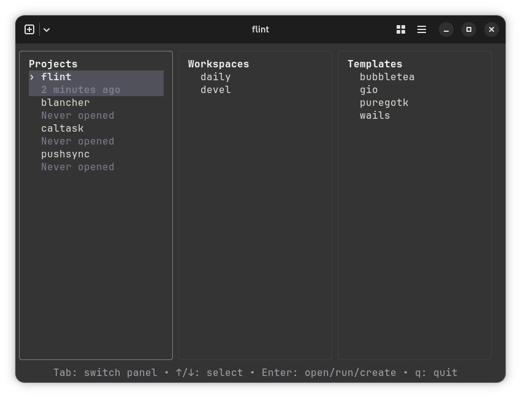

# Flint

Flint is a keyboard-driven CLI tool written in Go for managing projects, executing workspace scripts, and bootstrapping codebase templates directly from the terminal.

<div align="center">

</div>

## Features

- **3-Panel TUI Selector:** Interactive terminal layout built with Bubble Tea and Lipgloss. Fast navigation across Projects, Workspaces, and Templates.
- **Dynamic Pagination:** Automated height calculation with responsive page indicators per panel.
- **Template Engine:** Scaffold repositories using `template.yml` with placeholder variable substitutions (`%n`, `%p`, `%d`, `%y`, `{{.AUTHOR}}`) and post-creation hook execution.
- **Workspace Automation:** Run custom shell automation scripts (`.fws`) directly from the selector.

* **Scripting & JSON:** JSON output interfaces for integration with external scripts, shell automation, and pipelines.

## Installation

### Pre-compiled Downloads

Download from the [Releases](https://github.com/sunaipa5/flint/releases) page:

| OS          | Architecture            | Package Format  | Target Distributions            | File Name                             |
| ----------- | ----------------------- | --------------- | ------------------------------- | ------------------------------------- |
| **Linux**   | `amd64` / `arm64`       | RPM Package     | Fedora, RHEL, CentOS, openSUSE  | `flint_<version>_linux_<arch>.rpm`    |
| **Linux**   | `amd64` / `arm64`       | DEB Package     | Ubuntu, Debian, Pop!_OS, Mint   | `flint_<version>_linux_<arch>.deb`    |
| **Linux**   | `amd64` / `arm64`       | APK Package     | Alpine Linux                    | `flint_<version>_linux_<arch>.apk`    |
| **Linux**   | `amd64` / `arm64`       | Tarball Archive | Arch Linux, Void, Generic Linux | `flint_<version>_linux_<arch>.tar.gz` |
| **macOS**   | Apple Silicon (`arm64`) | Tarball Archive | macOS                           | `flint_<version>_darwin_arm64.tar.gz` |
| **macOS**   | Intel (`amd64`)         | Tarball Archive | macOS                           | `flint_<version>_darwin_amd64.tar.gz` |
| **Windows** | `amd64`                 | ZIP Archive     | Windows                         | `flint_<version>_windows_amd64.zip`   |

---

### Via Go Install

```bash
go install github.com/sunaipa5/flint@latest
```

Ensure `$GOPATH/bin` or `$(go env GOPATH)/bin` is added to your shell's `PATH`.

---

## Usage

```
*  .    .  (   *  .  (   *
  )   *     )   .     )   *
 _____ _     ___ _   _ _____
|  ___| |   |_ _| \ | |_   _|
| |_  | |    | ||  \| | | |
|  _| | |___ | || |\  | | |
|_|   |_____|___|_| \_| |_|
v1.0.0

Usage:
 flint                           Launch interactive project/workspace selector
 flint help                      Show CLI help instructions
 flint version                   Show Flint version
 flint editor [cmd]              Set or view default editor command

Projects:
 flint list                      List all registered projects
 flint select                    Launch interactive project/workspace selector
 flint open <name|id>            Open project in its editor
 flint dir                       Open last accessed project in file manager
 flint dir <name|id>             Open specific project in file manager
 flint last                      Open the most recently accessed project
 flint add                       Add a new project interactively
 flint add -n <name> -p <path>   Add a project via flags
 flint add -ps [-n <name>]       Select a project folder with a native dialog
 flint init [-n <name>]          Add the current directory as a project
 flint edit <name|id>            Edit an existing project
 flint rm <name|id>              Remove a project

Workspaces:
 flint ws                        Launch interactive workspace selector
 flint ws list                   List available workspace scripts (.fws)
 flint ws dir                    Open workspace scripts directory
 flint ws run <name>             Execute workspace script

Templates (aliases: tpl, template, tmpl):
  flint tpl                       List available templates
  flint tpl list                  List available templates
  flint tpl dir                   Print templates directory path
  flint tpl init                  Create template.yml in current directory
  flint tpl new <tpl> <name>      Create project from template
    Flags:
      -v, --var KEY=VALUE         Override template variable (can be used multiple times)

Scripting & Automation:
 flint projects-json             Output all projects as JSON
 flint project-json <name|id>    Output specific project as JSON
 flint last-project-json         Output last accessed project as JSON
 flint workspaces-json           Output all workspaces as JSON
 flint templates-json            Output all templates as JSON
 flint config-json               Output config as JSON
 flint last-project-name         Output last project name
 flint last-project-path         Output last project path
 flint project-path <name|id>    Output project path
 flint config-path               Output config directory path
 flint workspaces-path           Output workspaces directory path
 flint templates-path            Output templates directory path
 flint projects-path             Output projects.json file path
```

---

## Configuration

Flint stores its settings and registered projects under the standard user config directory:

- **Linux:** `~/.config/flint/`
- **macOS:** `~/Library/Application Support/flint/`
- **Windows:** `%APPDATA%\flint\`

---

## Templates (aliases: tpl, template, tmpl)

Templates are stored in the `templates` directory inside the Flint configuration path:

- **Linux:** `~/.config/flint/templates/`
- **macOS:** `~/Library/Application Support/flint/templates/`
- **Windows:** `%APPDATA%\flint\templates\`

Each template is a directory containing a `template.yml` config file and any files/folders to copy.

### Creating a Template

1. **Access Directory:** Run `flint tpl dir` to open the templates directory.
2. **Create Template Folder:** Make a new directory (e.g., `my-template/`).
3. **Add `template.yml`:** Run `flint tpl init` inside the template folder, or create manually:

```yaml
# template.yml
vars:
  author: "Your Name"
  license: "MIT"
cmds:
  - echo "Initializing project %n..."
  - git init
  - echo "Project %n created at %p on %d"
```

4. **Add Template Files:** Place files and folders in the template directory. Use placeholders in filenames and contents:

```
my-template/
├── template.yml
├── src/
│   └── %n_main.go
└── README.md
```

### Using a Template

```bash
# List available templates
flint tpl list

# Create a project from template
flint tpl new my-template my-project

# Override template variables
flint tpl new my-template my-project -v author="John Doe" -v license="Apache-2.0"
```

### Placeholder Conventions

Variables are substituted in **file contents**, **file paths**, **folder paths**, and **commands**:

| Placeholder | Variable      | Source                                 |
| ----------- | ------------- | -------------------------------------- |
| `%n`        | `NAME`        | Project name (from `tpl new <name>`)   |
| `%p`        | `PROJECT_DIR` | Absolute path of created project       |
| `%d`        | `DATE`        | Current date (YYYY-MM-DD)              |
| `%y`        | `YEAR`        | Current year (YYYY)                    |
| `%<key>`    | Custom        | From template `vars` or `-v` overrides |

**Priority order:** Built-ins < Template defaults < CLI overrides (`-v`)

### Template Variables

Flint supports two types of variable substitutions in **file contents** and **commands**:

1. **Built-in Variables (`%` syntax):** Provided automatically by Flint.
   - `%n` : Project Name
   - `%p` : Project Path
   - `%d` : Current Date
   - `%y` : Current Year

2. **Custom Variables (`{{.KEY}}` syntax):** Defined by the user in `template.yml`. Variable names are case-insensitive.

```yaml
vars:
  author: "Name"
  license: "MIT"

cmds:
  - echo "Initializing %n (%p)..."
  - echo "Created by {{.AUTHOR}} under {{.license}} in %y"
ignore:
  - "*.jar"
  - "gradle/wrapper/"
```

- **vars**: Map of default variable values. Overridable via `-v KEY=VALUE`.
- **cmds**: Shell commands executed sequentially inside the new project directory. Placeholders are expanded before execution.
- ignore: List of file or directory patterns (supports globs like *.jar and directory prefixes like gradle/wrapper/) copied directly as raw bytes without variable substitution. Binary files are also skipped automatically.

### Example Template Structure

```

~/.config/flint/templates/go-cli/
├── template.yml
├── main.go
├── go.mod
├── README.md
└── internal/
└── config.go

```

`template.yml`:

```yaml
vars:
  module: "github.com/user/%n"
  author: "Your Name"
cmds:
  - echo "Creating {{.MODULE}}..."
  - go mod tidy
  - git init
```

`main.go`:

```go
package main

// Project: %n (or {{.NAME}})
// Module: %module (or {{.MODULE}})
// Author: %author (or {{.AUTHOR}})
// Year: %y (or {{.YEAR}})
func main() {}
```

Running `flint tpl new go-cli myapp` creates:

```
/path/to/myapp/
├── main.go           (with substituted values)
├── go.mod            (with substituted values)
├── README.md         (with substituted values)
└── internal/
    └── config.go     (with substituted values)
```

And runs `go mod tidy` and `git init` inside `/path/to/myapp/`.

---

## Workspaces (`.fws`)

Workspace scripts are stored in the `workspaces` directory inside the Flint configuration path:

- **Linux:** `~/.config/flint/workspaces/`
- **macOS:** `~/Library/Application Support/flint/workspaces/`
- **Windows:** `%APPDATA%\flint\workspaces\`

### Creating and Running Scripts

1. **Access Directory:** Run `flint ws dir` to open the workspaces directory.
2. **Create Script File:** Create an executable shell script with a `.fws` extension (e.g., `dev.fws`).
3. **Script Content:**

```bash
#!/bin/sh
# dev.fws - Development workspace runner

echo "Starting development environment..."
flint last
# Launch editor, service containers, background apps, etc.
```
